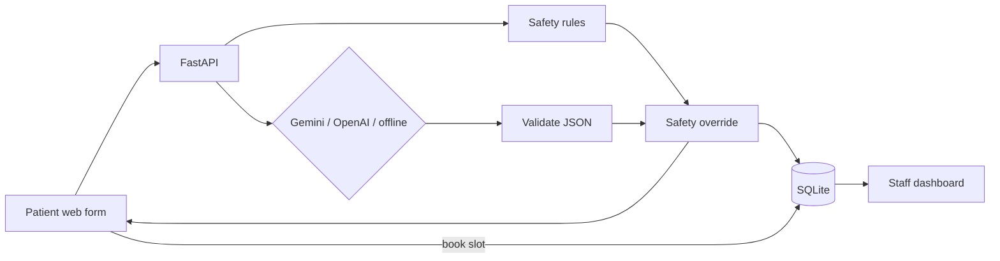

# ClinicFlow AI - AI Patient Intake & Appointment Automation for GP Clinics

> Patients describe symptoms in their own words -> AI writes a structured note for the doctor and sets the urgency
> -> safety rules catch emergencies -> the patient books the right appointment -> staff see a queue sorted by urgency.

Built for the **Gokul Infocare - AI Growth & Automation Associate** assessment (Task 1). Domain: **Healthcare**.
Areas covered: **Web application + AI automation + innovation**.


## Features
- **AI triage**: Google Gemini (or OpenAI/Groq) turns free text into JSON: urgency, clinical summary, key symptoms,
  suggested appointment type, questions for the doctor and a friendly patient message.
- **Safety first**: rule-based red-flag detector (chest pain, stroke, breathing, bleeding, anaphylaxis, suicide)
  always overrides the AI, shows "Call 000" and blocks online booking.
- **Smart booking**: urgent patients only see today's and tomorrow's slots; no double-booking.
- **Staff dashboard**: password-protected, stats, queue sorted by urgency, patient detail, status updates.
- **Reliable AI**: JSON mode + schema validation + retry + offline fallback engine. The demo works even without an API key.
- **Prompt-injection defence** and a **prompt evaluation script** (12 cases, unsafe under-triage must be 0).
- **Production basics**: Docker (non-root, health check), `render.yaml` one-click deploy, GitHub Actions CI, 20 tests.

## Quick start
```bash
python -m venv .venv && source .venv/bin/activate     # Windows: .venv\Scripts\activate
pip install -r requirements-dev.txt
cp .env.example .env            # optional: add GEMINI_API_KEY (free at https://aistudio.google.com/app/apikey)
uvicorn app.main:app --reload
```
- Patient app: http://localhost:8000
- Staff dashboard: http://localhost:8000/admin (password = `ADMIN_PASSWORD`, default `admin123`)
- API docs: http://localhost:8000/docs

Or with Docker: `docker compose up --build`

Run tests and the prompt evaluation:
```bash
pytest -q
python scripts/evaluate.py
```

## Architecture

Tech: Python 3.12, FastAPI, Pydantic, httpx, SQLite, vanilla HTML/CSS/JS, Docker. Details: [docs/ARCHITECTURE.md](docs/ARCHITECTURE.md)

```
app/
  main.py        API endpoints + pages
  ai_engine.py   LLM calls, JSON parsing, fallback, safety override
  prompts.py     versioned system prompt (v3)
  safety.py      red-flag rules
  database.py    SQLite
  slots.py       appointment slots (clinic time zone)
  config.py      env-based settings
static/          patient page + staff dashboard
tests/           pytest suite
scripts/         prompt evaluation
docs/            architecture, prompts, deployment, video script, interview guide, screenshots
```

## Screenshots
| Intake | Emergency detected | Staff dashboard |
|---|---|---|
|  |  |  |

## Documentation
- [Prompt documentation](docs/PROMPT_DOCUMENTATION.md): all prompts and how they evolved (v1 -> v3)
- [Architecture](docs/ARCHITECTURE.md)
- [Deployment guide](docs/DEPLOYMENT.md) (local, Docker, Render)
- [Video script](docs/VIDEO_SCRIPT.md)
- [Interview guide](docs/INTERVIEW_GUIDE.md)

## Disclaimer
Demo project. ClinicFlow AI does not diagnose and is not a medical device. In an emergency in Australia call **000**.
